# TRYSA Share

Share photos, videos and files with anyone nearby or anywhere. Receivers don't need an account. Everything runs on one Cloudflare Worker for `link.trysa.app`:

| Path | What it is |
|---|---|
| `/share/` | The TRYSA Share app: an installable web app with a share sheet, Nearby, QR, Contacts, Inbox and Sent |
| `/s/:code` | Public receiver page for QR codes and links (no app, no account) |
| `/api/share/v1` | Transfer API, plus the Nearby WebSocket |

> **Status: built and tested locally, not deployed.** Two Supabase migrations are *proposed* and have **not** been applied. No Worker routes are live. `link.trysa.app/hicc-gallery` and other permanent QR codes are untouched.

## Screens
| Nearby | Share sheet | Person card | Incoming request |
|---|---|---|---|
| 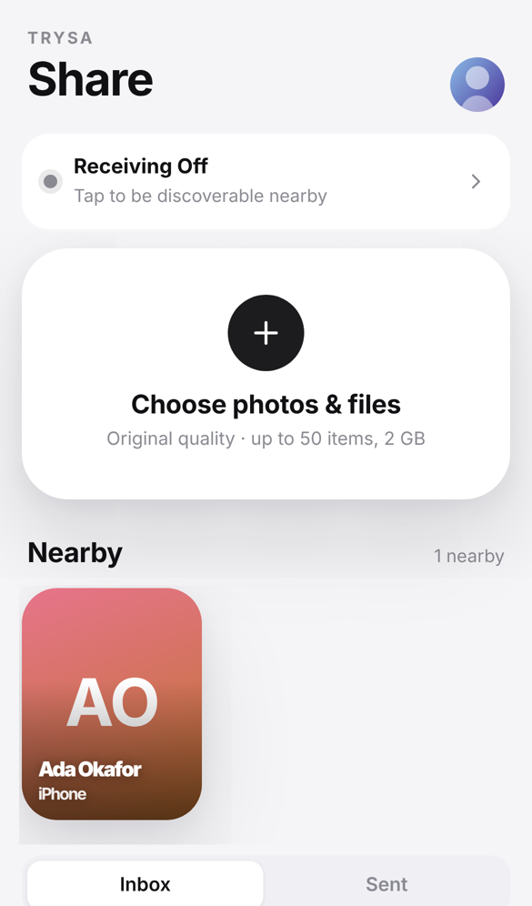 | 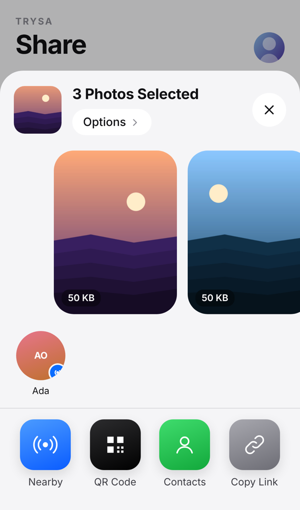 | 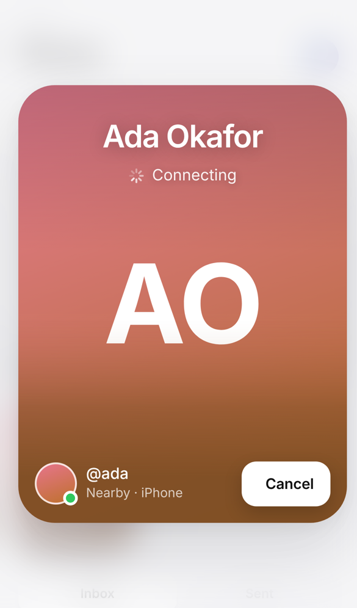 | 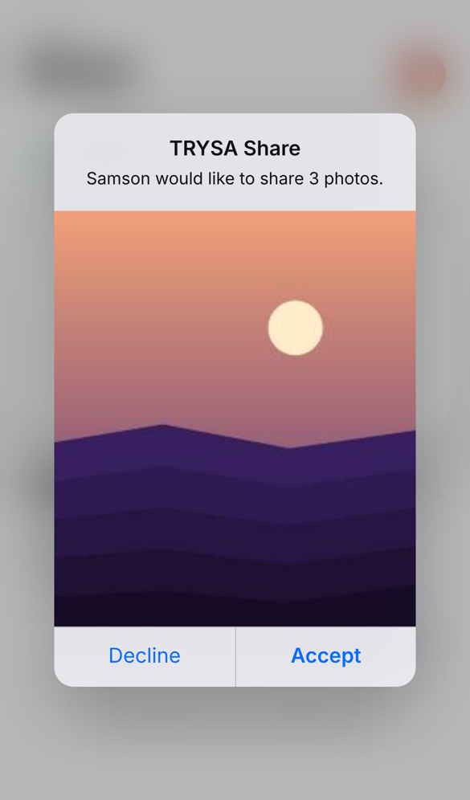 |
| **Delivered** | **Received** | **QR Send** | **Browser receiver** |
| 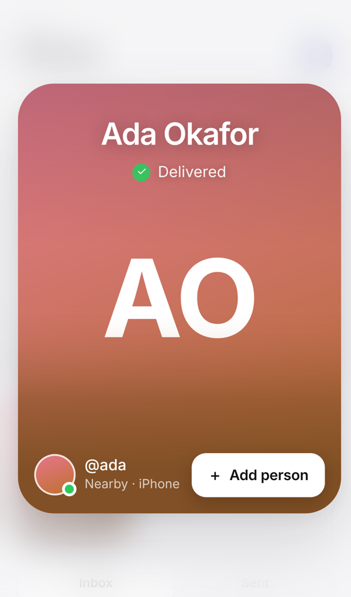 | 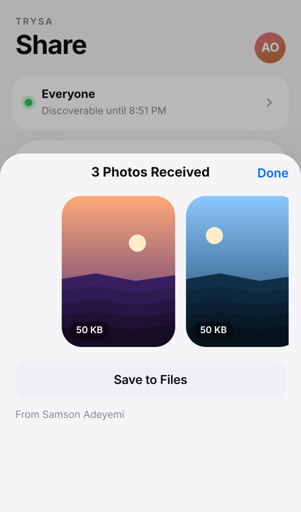 | 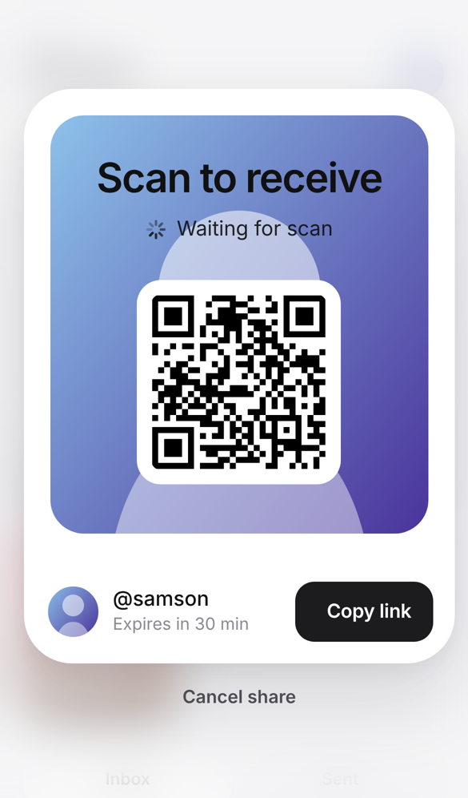 | 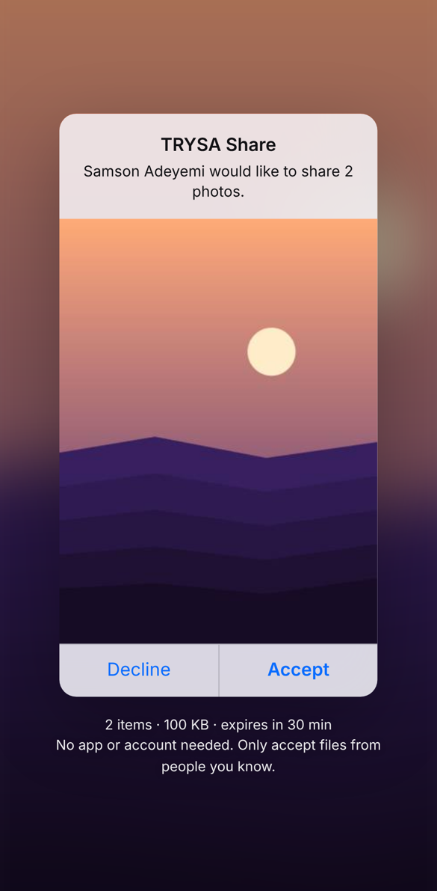 |
| **Contacts** | **Remote request (dark)** | **Received (dark)** | **Browser files** |
| 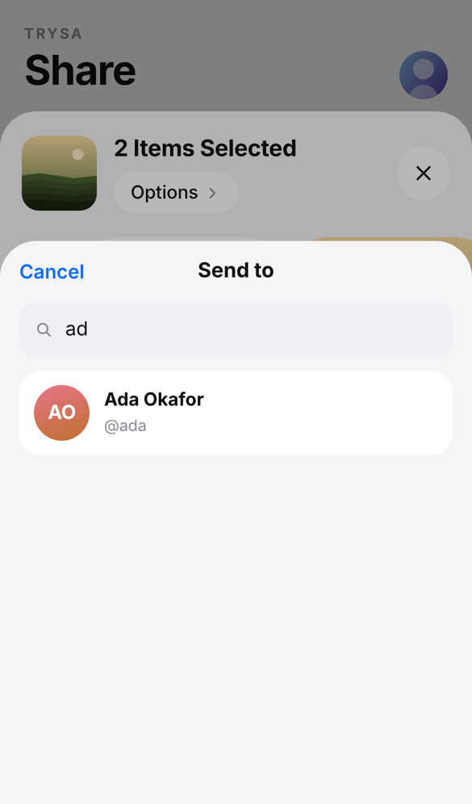 | 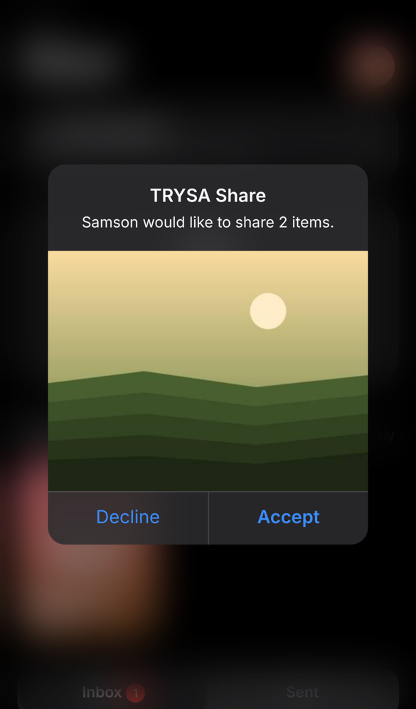 | 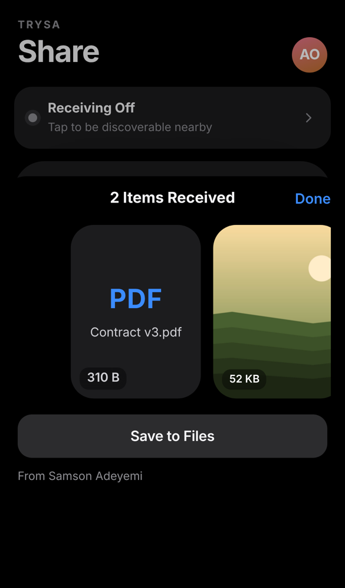 | 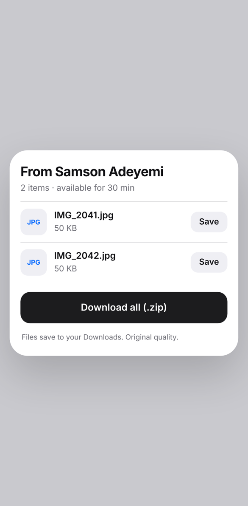 |

These screenshots come from the automated end-to-end run (`npm run e2e`). They use test accounts and generated images.

## Features
- **Share sheet.** It works like a phone's built-in share sheet:
  - pick files to get "3 Photos Selected", an Options pill and a scrolling preview of the selection;
  - below that, a row of nearby people, then Nearby, QR Code, Contacts and Copy Link;
  - on Android and desktop, installing the app adds TRYSA Share to the system share sheet.
- **Nearby (phone to phone).**
  - **Discovery:** you only see people on the same network who switched Receiving on, for at most 10 minutes. You can limit it to Contacts Only.
  - **Transfer:** the files go **directly between the two devices** over an encrypted WebRTC data channel.
  - **Delivered:** the sender's card shows Connecting → Waiting → Sending % → Delivered. Delivered appears only after the receiver confirms every file arrived complete.
  - **Fallback:** if a direct connection fails, one tap sends through the TRYSA cloud instead.
- **Incoming request.** A "Samson would like to share 3 photos." alert, with an optional preview, Decline and Accept. Nothing transfers before Accept.
- **QR Send.** A card with the QR code and live status: Waiting for scan → Opened → Accepted → Delivered.
  - The receiver's browser shows the same alert design. They can save files one by one, as a single **"Download all (.zip)"**, or with "Save to Photos" where the browser supports it.
- **Contacts.** You can search people in your workspaces and people you've shared with before. Anyone else can only be found by their exact @username, so there's no open directory of users.
  - Each recipient gets an in-app alert, plus a **push notification** when they've turned notifications on and the app is closed.
- **Resumable uploads.** Files over 6 MB upload in chunks and resume after a dropped connection. If resumable upload isn't available, the app falls back to a single upload.
- **Safety checks when the sender finishes uploading:**
  - apps and programs (`.exe`, Linux and Mac executables) are blocked;
  - photos, videos and PDFs whose content doesn't match their type are rejected;
  - an optional malware-scanner hook (`SCANNER_URL`) can be added. **The built-in checks are not antivirus.**
- **Previews.** A small preview image, with photo metadata (including location) removed, made on the sender's phone. It's shown before Accept only if the sender allows it.
  - Always on for Contacts and Nearby.
  - Off by default for QR codes and links (switch it on in Options).

## How it fits together
```
phone app (/share)  ──HTTPS──▶  Worker  ──service role──▶  Supabase (tables, private bucket)
      │  ▲                        │
      │  └── WebSocket ──▶ NearbyRoom Durable Object (one per network; presence + connection setup only)
      └──────── direct WebRTC data channel (files) ────────▶ other phone
browser receiver (/s/:code) ──▶ Worker streams files from the private bucket (no file links handed out)
```

## Repository
```
worker/
  src/app.js            API, receiver, streamed downloads + ZIP, contacts, push, Nearby auth, app shell headers
  src/nearby.js         NearbyHub (rules) + NearbyRoom Durable Object
  src/zip.js            streaming ZIP writer with exact Content-Length
  src/sniff.js          content checks + optional scanner hook
  src/push.js           Web Push (VAPID), empty pushes only
  src/core.js, db.js    validation, state machines, Supabase REST client
  public/share/         the app: index.html, app.css, app.js, nearby-client.js, sw.js, manifest, icons, vendor/
  test/                 51 unit/API tests (node --test)
  e2e/                  real workerd + mock Supabase + Playwright (two phones + a browser)
supabase/migrations/    v2 (QR/browser receivers) and v3 (previews, push, resumable uploads), both proposed
docs/DEPLOY.md          staging → production runbook
```

## Run it
```
cd worker && npm install
npm test          # 51 tests
npm run e2e       # 11 end-to-end checks, real WebRTC between two emulated phones
```

## Fixes over the Remote Send v1 starter
- `create` always failed, because it inserted `workspace_id = null` into a `NOT NULL` column.
- Browser receivers were impossible.
- Signed links stayed valid after revoke.
- "Downloaded" was reported by the client.
- `publish` only checked that a file existed.

## What this does *not* do (yet)
- **No native iOS/Android apps or iOS share extension.** This is an installable web app. On iPhone it can't appear in the system share sheet, and notifications need it added to the Home Screen (iOS 16.4+).
- **No Bluetooth/AirDrop-style discovery.** Browsers can't scan Bluetooth or Wi-Fi Direct, so Nearby means "same network". Phones on different networks, or networks that block direct device-to-device connections, use the cloud fallback.
- **No system-level incoming pop-up when the app is closed.** A push notification opens the app's Accept/Decline alert. No pop-up appears without the user's permission.
- **No end-to-end encryption for cloud transfers.** They use TLS plus a private bucket; we don't claim more. Nearby transfers are encrypted between the two devices (DTLS).
- **Phone memory limits.** Very large Nearby transfers are held in the receiving browser until saved.
- Malware scanning needs an external scanner service.

The OpenDrop archive (GPLv3) was reviewed. **None of its code is used.**
