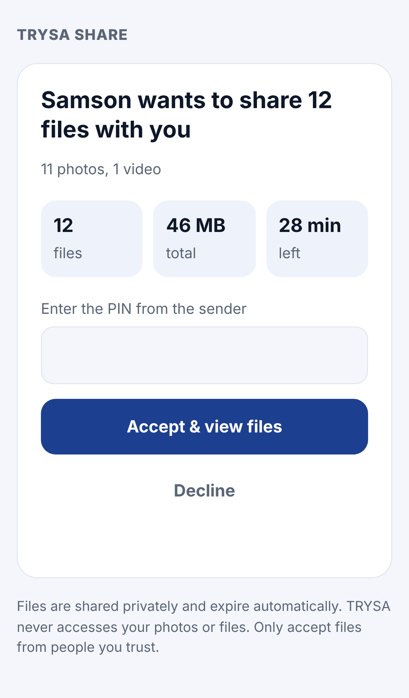
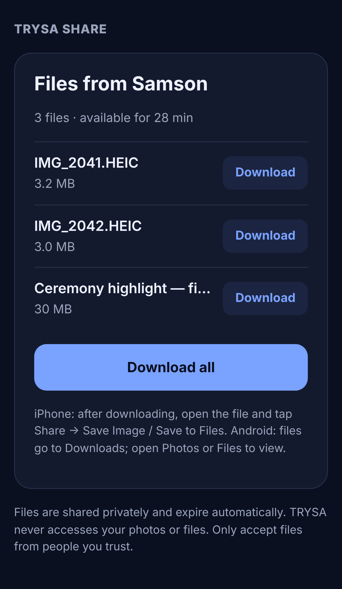

# TRYSA Share

Phase 1 of the TRYSA Share PRD: **Universal QR Send + browser receiving**, plus **Remote Send** between TRYSA accounts, all handled by one Cloudflare Worker on `link.trysa.app`.

> **Status: built and tested locally, not deployed.** The Supabase migration is *proposed* and has not been applied. No Worker routes are live. `link.trysa.app/hicc-gallery` and other permanent QR codes are untouched.

| Receiver preview (before accept) | After accept |
|---|---|
|  |  |

## Why a Worker instead of a Supabase Edge Function
The Remote Send v1 Edge Function couldn't be deployed because the project has reached its Edge Function limit. The PRD already places the edge gateway on Cloudflare Workers (§8), so the whole transfer API runs there instead. It talks to the existing Supabase tables and private bucket using the service-role key, which is stored only as a Worker secret. This needs **no new Supabase function slot**.

## What's here
```
worker/                      Cloudflare Worker (no runtime dependencies)
  src/core.js                validation, codes, PIN hashing, PRD §9 state machines (pure)
  src/app.js                 sender API, browser receiver, streamed downloads, cleanup cron
  src/db.js                  minimal Supabase REST/Storage/Auth client
  src/pages/receiver.js      /s/:code — no-install, no-account receiver page
  src/pages/sender.js        /share — staging sender console (QR / TRYSA user / Inbox / History)
  test/                      27 tests incl. PRD §11 acceptance tests 1,2,5,6,7,8 at API level
supabase/migrations/         proposed v2 schema change (not applied)
docs/DEPLOY.md               step-by-step staging → production runbook
```

## How it works
**QR Send:** the sender picks files and taps *Generate QR*. The Worker creates an `uploading` session and returns signed upload URLs. The phone uploads straight to the private bucket. Then `publish` checks each stored object's size (and its SHA-256 when supplied) before the session becomes `ready`, so **the QR only works once the files are ready**.

**Browser receiver:** scanning the QR opens `link.trysa.app/s/CODE`. Before accepting, the page shows the sender's name, file count, kinds (e.g. "11 photos, 1 video"), total size and time left. **File names stay hidden until the receiver accepts.** Tapping Accept claims a receiver slot through an atomic RPC and sets an HttpOnly, path-scoped claim cookie.

**Downloads stream through the Worker.** No signed file URL ever reaches a receiver, so:
- revoking takes effect immediately, and the files are deleted;
- "downloaded" is recorded by the **server** when every byte of every file has been delivered, not reported by the client;
- Range requests let interrupted downloads resume, and repeats never create duplicate receipts.

**Remote Send** keeps the v1 flow (sender → recipient account → Inbox → Accept → download) on the same API. It also writes a `connect_notifications` row when the sender shares from a workspace.

**Safety defaults (PRD §10):**
- QR links expire after 30 minutes by default, for 1 receiver.
- The sender can allow up to 20 receivers for one-to-many sharing.
- Optional 4–8 digit PIN, locked after 5 wrong attempts.
- 10-character codes avoid look-alike characters (0/O, 1/I/L).
- Per-IP rate limits.
- Scan events store a hashed visitor key, never the IP address.
- Strict CSP on the receiver page.
- A cron job every 15 minutes deletes expired, revoked and failed transfers.

## Fixes over the Remote Send v1 starter
- `create` would always have failed: it inserted `workspace_id = null`, but that column is `NOT NULL`. The migration makes it nullable, and the API checks workspace membership when an ID is supplied.
- Browser receivers were impossible because `receiver_user_id` was `NOT NULL`. Browser receipts now use a hashed claim token.
- 60-second signed links stayed valid after revoke. They're replaced by streaming through the Worker.
- `downloaded` was client-reported. It's now confirmed by the server.
- `publish` only checked that an object existed. It now checks the object's size and its hash when one is supplied.
- Added the full PRD §9 status set and idempotent events.

## Run tests
```
cd worker && npm install && npm test
```

## Not yet built (later phases)
- Native iOS/Android app screens, share-sheet extension and push delivery (Phase 2).
- Nearby discovery and direct local transfer (Phases 2–3).
- ZIP packaging for multi-file downloads.
- Malware scanning.
- Resumable *uploads* (TUS).
- Contact picker for Remote Send (the staging UI asks for a user ID).

The OpenDrop archive (GPLv3, experimental AirDrop for macOS/Linux) was reviewed per PRD §13. **None of its code is used here.**
